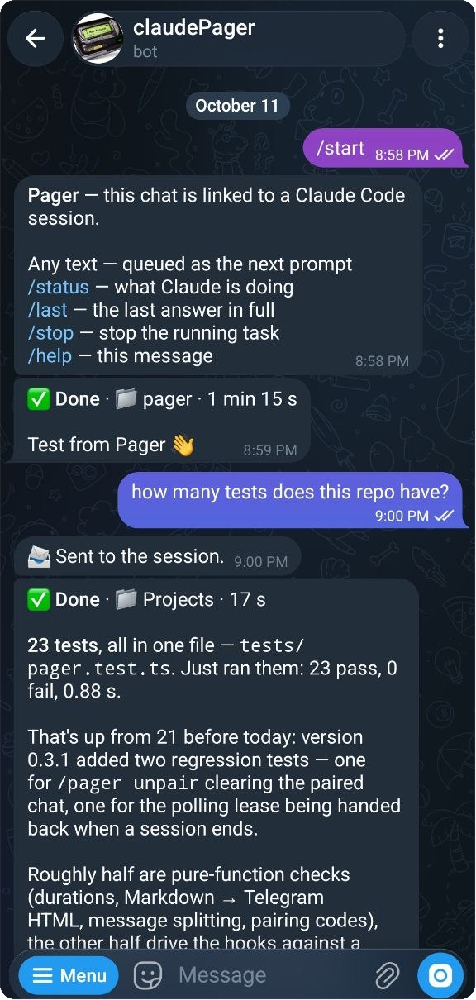
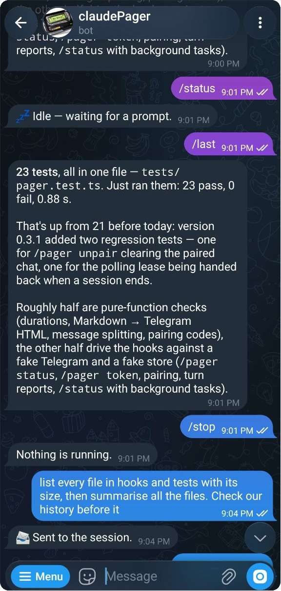
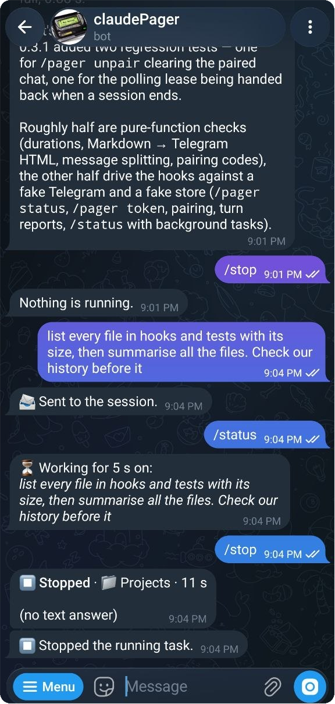

# Pager 📟

**Claude Code в кармане: сообщение в Telegram, когда задача готова или Claude ждёт вашего разрешения, — а в ответ можно прислать следующий запрос.**

Мод (плагин на функциональных хуках) для Claude Code. Без сервера, без Bun и без лишних флагов: мод говорит с вашим собственным Telegram-ботом через сеть Claude Code, а отвечать ему может только привязанный чат.

[English version](README.md)

<p align="center">
  
</p>

## Что умеет

- ✅ **Готово** — когда ход дольше *N* секунд закончился, в чат приходят папка проекта, время и ответ Claude (длинный обрезается по слову, `/last` пришлёт целиком).
- ⏸ **Ждёт вас** — когда Claude остановился и спрашивает разрешение или ввод, приходит вопрос.
- 📨 **Следующий запрос из Telegram** — любое сообщение боту встаёт в очередь сессии как ваш запрос и выполняется, как только Claude освободится. О таком ходе Pager сообщает всегда, даже о коротком.
- `/status` — свободен или над чем работает и сколько
- `/last` — последний ответ целиком
- `/stop` — остановить текущую задачу
- Открыто несколько окон Claude Code? Уведомляют все, а слушает бота одно (аренда в хранилище мода: Telegram разрешает одного читателя на бота).

## Команды бота

| | |
|---|---|
| любой текст | встаёт в очередь сессии как ваш запрос |
| `/status` | свободен или над чем работает и сколько |
| `/last` | последний ответ целиком |
| `/stop` | остановить текущую задачу |
| `/help` | список выше |

Кнопка **Меню** в чате показывает то же самое — Pager заполняет её при старте и при привязке.

<p align="center">
  
  
</p>

## Установка

```
/plugin install pager --marketplace vihrea1337/pager
```

Ответьте `y` на добавление маркетплейса, выберите область user и вставьте токен бота, когда спросят (он уходит в защищённое хранилище Claude Code).

## Бот за 2 минуты

1. В Telegram откройте **@BotFather** → `/newbot` → имя → username с окончанием `bot`. Скопируйте токен (`1234567890:AA…`).
2. Если пропустили токен при установке: `/pager token <токен>` в Claude Code.
3. Напишите своему боту что угодно — он ответит 6-значным кодом.
4. В Claude Code: `/pager pair <код>`. Готово — `/pager test` пришлёт пробное сообщение.

Дальше бот слушает только этот чат, сообщения от остальных молча отбрасываются.


## Настройки (`/config` → pager)

| Настройка | По умолчанию | |
|---|---|---|
| Notify after (seconds) | 0 | Сообщается о каждом ходе. Поднимите значение — и быстрые ответы, которые вы и так видели, перестанут дёргать телефон; ходы из Telegram приходят всегда. |
| Notify when waiting | вкл | Сообщение «ждёт разрешения / ввода» |
| Accept prompts from Telegram | вкл | Выкл — только уведомления |
| Desktop notification too | выкл | Ещё и системное уведомление на компьютере |
| Language | en | `en` или `ru` |

`/pager` без аргументов покажет, что настроено: токен, чат, какая сессия слушает.

## Безопасность

Сообщение боту становится запросом в сессии, которая может править файлы и запускать команды, поэтому:

- слышен только **привязанный чат** — для привязки нужен код, показанный в этом чате *и* введённый в вашем терминале;
- токен хранится в защищённом хранилище Claude Code (или в хранилище мода, если задан через `/pager token`); если он утёк — `/revoke` в @BotFather;
- запросы разрешений по-прежнему останавливают сессию: одобрять действия из Telegram в 0.1 сознательно нельзя.

## Как устроено

Вся логика — чистые функции в [`hooks/core.ts`](hooks/core.ts) (форматирование, разбор сообщений, аренда опроса); [`hooks/register.ts`](hooks/register.ts) подключает их к движку: `turn.start`/`turn.complete` → «готово», `classic.Notification` → «ждёт вас», таймер → `getUpdates` → `$.prompt.submit`, `/stop` → `$.turn.abort`. Тесты — на тест-ките движка с поддельными Telegram и хранилищем: `claude plugin test .`

## Лицензия

MIT
